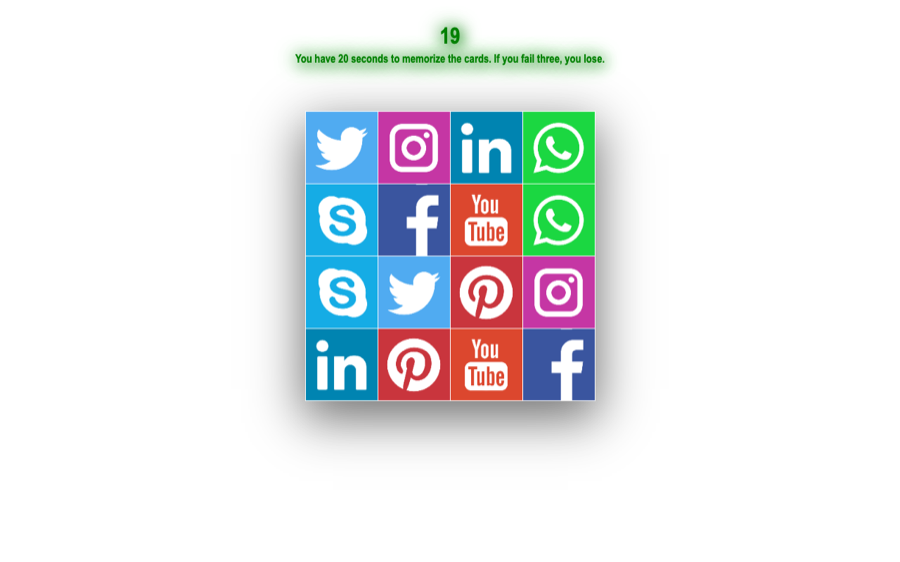

# Memory Card Game

A memory game: flip cards and find pairs of matching icons.

**[Play online →](https://ceyhun1999.github.io/Memory-Card-Game/)**

<p align="center"></p>

## How to play

1. All cards are face up for 20 seconds, so memorize their positions
2. Then they flip down; open two cards in a row
3. A match stays open, a mismatch flips back
4. Three mistakes and you lose

## Project structure

```
├── index.htm
├── style.css
├── javascript.js   # timer, card layout, pair checking
└── img/            # social network icons
```

## Run locally

No build step. Open `index.htm` in a browser, or start a local server:

```bash
python3 -m http.server 8000
```

Then go to http://localhost:8000.

## Tech stack

HTML · CSS · JavaScript (no libraries)
